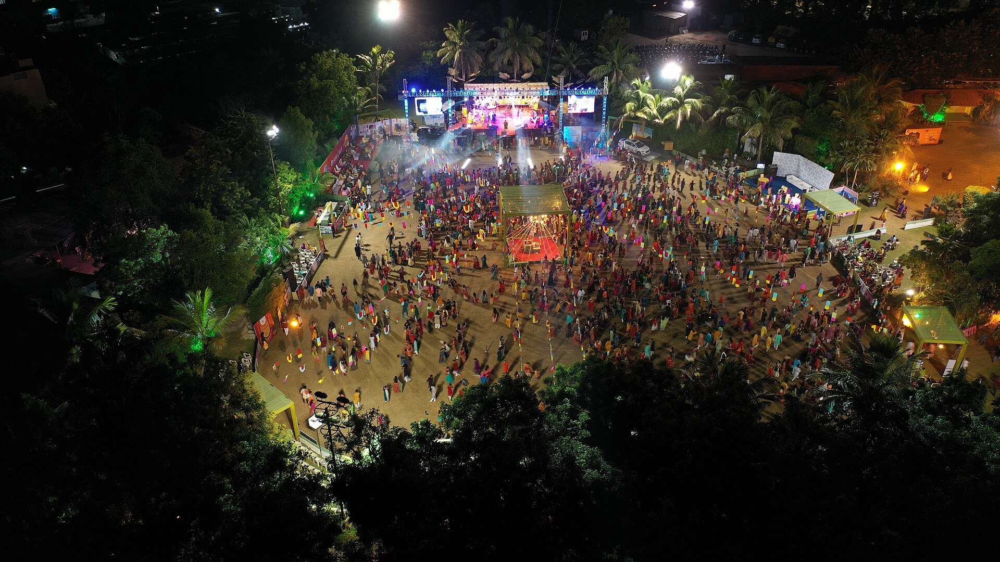

# RaasPass Navratri WebMCP Demo Guide


RaasPass is a mock Navratri garba-pass booking experience for Gujarat. It demonstrates how a browser agent can discover venues, verify event perks, navigate between screens, and complete a pass form through WebMCP.

> All venues, passes, prices, and payments in this demo are fictional or mocked.

## 1. Prerequisites

- Node.js 22 or newer
- npm 10 or newer
- Chrome 150 or newer
- The **WebMCP for testing** Chrome flag enabled
- The **WebMCP - Model Context Tool Inspector** extension
- A Gemini API key only if you want natural-language agent chat

Enable local WebMCP:

1. Open `chrome://flags/#enable-webmcp-testing`.
2. Set **WebMCP for testing** to **Enabled**.
3. Relaunch Chrome.
4. Install the [Model Context Tool Inspector](https://chromewebstore.google.com/detail/model-context-tool-inspec/gbpdfapgefenggkahomfgkhfehlcenpd).

## 2. Install and start

From PowerShell:

```powershell
Set-Location "C:\Users\PWFN83\practice_work\KCDG_2026\poc\webmcp-tools\demos\hotel-chain"
npm ci
npm run dev
```

Open the URL printed by Vite, normally:

```text
http://localhost:5173/
```

Keep that terminal running during the presentation. Stop it afterward with `Ctrl+C`.

### Production check

Run this before presenting:

```powershell
npm run build
```

The build should finish with `built in ...` and no TypeScript errors.

## 3. Open the inspector

1. Open `http://localhost:5173/` in Chrome.
2. Click the Extensions icon and pin **WebMCP - Model Context Tool Inspector**.
3. Open the inspector side panel.
4. Refresh RaasPass while the side panel is open.
5. Confirm the home-page tools include `search_location`, `lookup_amenity`, and `view_hotel`.

Tools are route-scoped. After navigation, the inspector refreshes its list:

| Screen | Tools expected |
| --- | --- |
| Home | `search_location`, `lookup_amenity`, `view_hotel` |
| Search results | Home tools plus `filter_search_results`, `reset_filters`, `get_hotel_search_results` |
| Venue details | Home tools plus `start_booking` |
| Pass checkout | Home tools plus declarative `complete_booking` |



## 4. Recommended live demo

Use short prompts one at a time. Wait for the page and inspector tool list to update after each navigation.

### Step 1: Search Ahmedabad

Prompt:

```text
Find Navratri passes in Ahmedabad for October 10, 2026 for two adults.
```

Expected result:

- The agent calls `search_location`.
- The page navigates to Ahmedabad results.
- The date becomes October 10, 2026.
- Any price or perk filters from an earlier search are cleared.
- The tool response includes the matching venue IDs, prices, ratings, and perks.

### Step 2: Read structured results

Prompt:

```text
List the available venues and their pass prices and perks.
```

Expected result:

- The agent calls `get_hotel_search_results`.
- It describes venues without scraping cards from the page.

If Gemini already summarizes the structured venues returned by Step 1, Step 2 is optional.

### Step 3: Open GMDC Ground

Prompt:

```text
Open GMDC Ground and tell me whether dining is available.
```

Expected result:

- The agent calls `view_hotel` with `GMDC Ground`.
- The response returns the stable ID `gmdc-ground` and available perks.
- The agent calls `lookup_amenity` with `hotel_id: "gmdc-ground"` and `amenity: "dining"`.
- The venue page opens and confirms the Gujarati Food Village.

### Step 4: Start checkout

Prompt:

```text
Start booking this pass.
```

Expected result:

- The agent calls `start_booking`.
- The app opens the pass checkout screen.

### Step 5: Complete the declarative form

Prompt:

```text
Complete the pass booking for Dhwani Suthar using dhwani.suthar@gmail.com.
```

Expected result:

- The agent discovers the declarative `complete_booking` form.
- It populates first name, last name, and email.
- The form auto-submits as part of the same tool call; do not send a second confirmation prompt.
- The app shows **Your pass is confirmed**.

## 5. Alternative filter demo

From the home page, run these prompts separately:

```text
Find Navratri passes in Ahmedabad.
```

```text
Only show venues with dining and free parking.
```

```text
List the matching venues as a short comparison.
```

This demonstrates `search_location`, `filter_search_results`, and `get_hotel_search_results`.

## 6. Manual fallback without Gemini

A Gemini key is not required to inspect or manually execute tools. In DevTools:

```js
const tools = await document.modelContext.getTools();
console.table(tools.map(({ name, description }) => ({ name, description })));
```

Chrome testing builds may require JSON-stringified arguments:

```js
const search = tools.find(tool => tool.name === "search_location");
await document.modelContext.executeTool(
  search,
  JSON.stringify({
    query: "Ahmedabad",
    checkin_date: "2026-10-10",
    adults: 2
  })
);
```

After every navigation, fetch the current tools again:

```js
const currentTools = await document.modelContext.getTools();
const venue = currentTools.find(tool => tool.name === "view_hotel");
await document.modelContext.executeTool(
  venue,
  JSON.stringify({ hotel_name_or_id: "GMDC Ground" })
);
```

Then refresh the tool list and start checkout:

```js
const venueTools = await document.modelContext.getTools();
const startBooking = venueTools.find(tool => tool.name === "start_booking");
await document.modelContext.executeTool(startBooking, JSON.stringify({}));
```

A navigation call may log an `AbortError` after returning a successful response. This is the previous route's tool-registration signal being cleaned up and does not mean the action failed.

## 7. Troubleshooting

### No tools appear

- Confirm Chrome is version 150 or newer.
- Confirm `chrome://flags/#enable-webmcp-testing` is enabled.
- Relaunch Chrome, reopen the inspector, and refresh the page.
- In DevTools, verify `typeof document.modelContext.getTools` returns `"function"`.

### Gemini returns HTTP 429

The API key has reached a rate limit or quota. Wait for the quota window to reset, use a billed key, or continue with manual tool execution. Avoid combining multiple full demo scenarios in one prompt.

### A route-specific tool is missing

Wait for navigation to complete, then refresh the inspector's tool list. `filter_search_results`, `start_booking`, and `complete_booking` are intentionally available only on their relevant screens.

### The page says "No passes found"

Run the Step 1 search prompt again. A new `search_location` navigation now clears all previous price and perk filters. If you are demonstrating manually, execute `reset_filters` on the results page.

### Port 5173 is busy

Vite automatically selects another port. Open the exact URL shown in the terminal.

## 8. Presentation close

The key message is that the agent is not guessing where to click. RaasPass exposes typed, route-aware capabilities that operate the same visible interface the audience sees, while the declarative checkout keeps the final form understandable and controllable by the user.

## 9. WebMCP vs DOM benchmark

The demo includes a deterministic A/B benchmark for the same end-to-end task:

- **WebMCP mode** uses five structured tools.
- **DOM mode** disables all WebMCP tools with `?webmcp=off` and drives the same visible controls with selectors.
- Both modes must reach the same **Your pass is confirmed** UI state.

Keep the Vite server running, open a second PowerShell terminal in this directory, and run:

```powershell
$env:BENCHMARK_RUNS = "5"
npm run benchmark
Remove-Item Env:BENCHMARK_RUNS
```

The runner warms up each mode once, alternates execution order to reduce bias, and writes:

- `benchmark-results/latest.html` — presentation-ready comparison.
- `benchmark-results/latest.json` — raw runs, steps, errors, and summary statistics.

Open the report:

```powershell
Start-Process .\benchmark-results\latest.html
```

### Metrics

| Metric | Meaning |
| --- | --- |
| Success rate | Runs that reached the visible booking confirmation |
| Median and p95 | End-to-end browser automation duration after warmup |
| Action count | Semantic tool calls versus individual DOM interactions |
| Step timings | Search, venue opening, perk verification, checkout, and submission |

### How to present the result

Lead with success rate and action count. WebMCP expresses this scenario in five domain actions; the DOM baseline currently requires twelve selector-level actions. Use latency as a secondary measurement because local browser timing varies by machine and cache state.

> This benchmark compares deterministic WebMCP invocation with deterministic DOM automation. It does not measure LLM screenshot understanding, reasoning quality, model tokens, or API cost. A true model benchmark requires the same multimodal browser agent and model for both variants.

## Image credits

The bundled images are resized copies from Wikimedia Commons:

- [A rasa garba dandiya dance, Navratri tradition](https://commons.wikimedia.org/wiki/File:A_rasa_garba_dandiya_dance,_Navratri_tradition.jpg) by Ed Uthman, [CC BY-SA 2.0](https://creativecommons.org/licenses/by-sa/2.0/).
- [Garba Folk Dance](https://commons.wikimedia.org/wiki/File:Garba_Folk_Dance.jpg) by Saurabh sirohiya, [CC BY-SA 4.0](https://creativecommons.org/licenses/by-sa/4.0/).
- [Bird Eye View of Navratri Ground](https://commons.wikimedia.org/wiki/File:Bird_Eye_View_of_Navratri_Ground.jpg) by Nitinbaldha, [CC BY-SA 4.0](https://creativecommons.org/licenses/by-sa/4.0/).
- [Garba night](https://commons.wikimedia.org/wiki/File:Garba_night.jpg) by Archi465, [CC BY-SA 4.0](https://creativecommons.org/licenses/by-sa/4.0/).

The images were resized by Wikimedia's thumbnail service; no other modifications were made.
